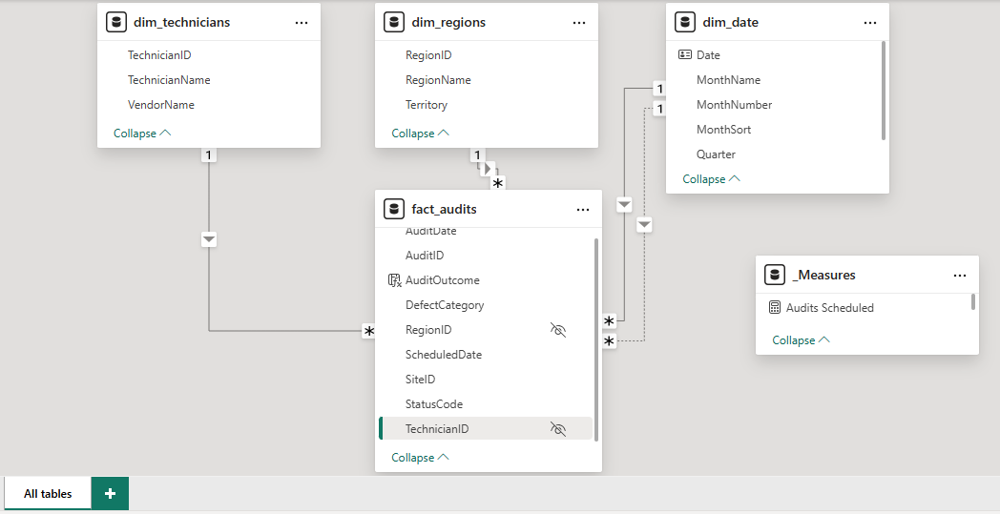
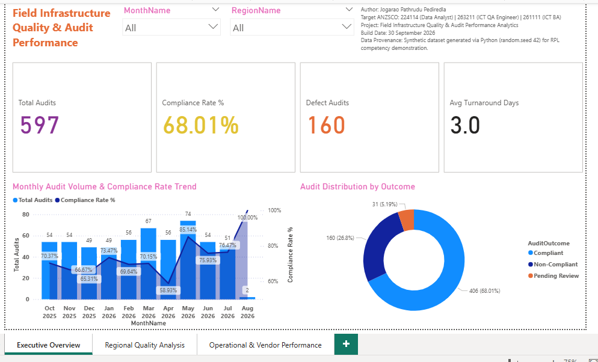
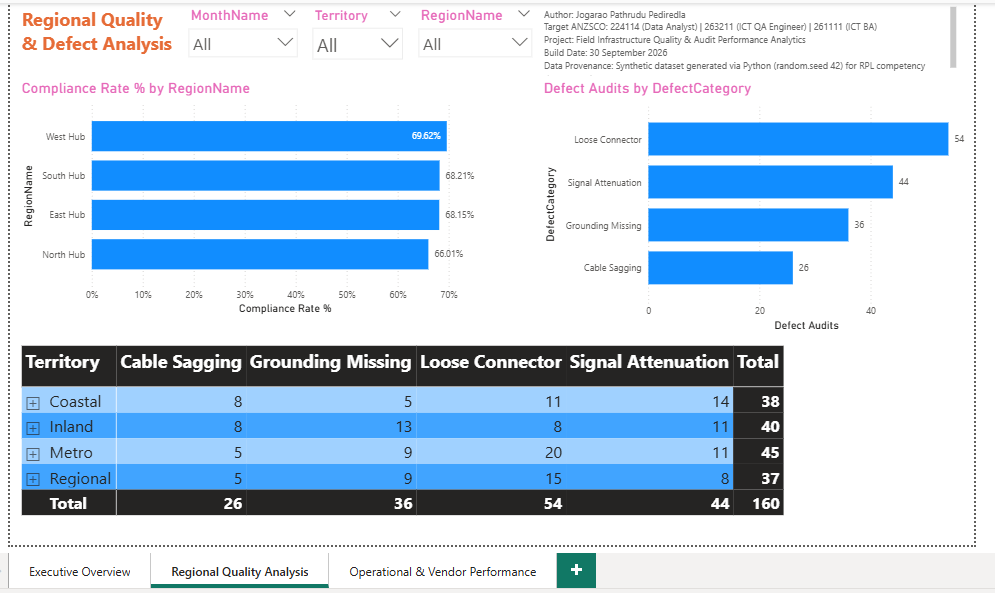
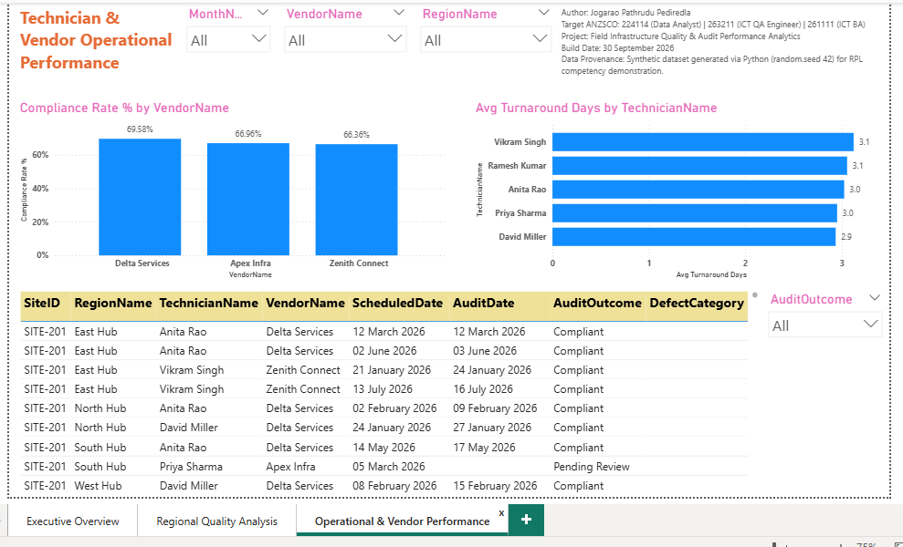

# Field Infrastructure Quality & Audit Performance Analytics

[](#semantic-model--key-dax-measures)
[](#database-schema--reporting-views)
[](#exploratory-data-analysis--validation-output)
[](#metadata--attribution)

An end-to-end operational data quality governance, relational data modeling, and business intelligence platform engineered to simulate field infrastructure audit lifecycles, enforce multi-tier automated data validation gates, track asset defect distributions, and evaluate contractor turnaround performance.

---

## Metadata & Attribution

* **Author:** Jogarao Pathrudu Pediredla
* **GitHub Profile:** [@PJPathrudu](https://github.com/PJPathrudu)
* **Public Repository:** [field-infrastructure-audit-analytics](https://github.com/PJPathrudu/field-infrastructure-audit-analytics)
* **Project Role:** Independent Project Developer — Data Quality & Analytics
* **Project Type:** Independent Professional Portfolio & Applied Engineering Simulation
* **Nominated Pathways:** ANZSCO 224114 (Data Analyst) & ANZSCO 263211 (ICT Quality Assurance Engineer) & ANZSCO 261111 (ICT Business Analyst)
* **Evidence Classification:** ACS RPL Professional Currency — Category 2 (Attributed Digital Artefact)

> **Scope Note:** This project represents an independent technical portfolio demonstration developed to exhibit competency in data architecture, automated testing assertions, dimensional modeling, and analytical reporting. It is not an employer-commissioned deployment or paid enterprise engagement.

---

## Project Overview

This analytics platform bridges three core computing domains across simulated field operations:
1. **Business Systems Analysis (ANZSCO 261111):** Formulates operational business logic, normalizes fragmented inspection codes, and evaluates architectural trade-offs between flat reporting views and relational star schemas.
2. **Quality Assurance Engineering (ANZSCO 263211):** Implements automated Python assertion gates, establishes relational constraints, executes automated SQL regression suites (TC-01 to TC-07), and models diagnostic 5-Whys Root Cause Analysis.
3. **Data Analytics & Modeling (ANZSCO 224114):** Generates, profiles, and validates synthetic transactional data using Python, implements MySQL fact and dimension tables, and designs an import-mode Kimball star-schema semantic model in Power BI.

---

## Data Provenance & Synthetic Disclosure

All transactional records are synthetically generated using Python (`random.seed(42)` and `numpy.random.seed(42)`) to simulate field audit lifecycles without using proprietary corporate data:

* **Reproducibility:** The supplied notebook uses fixed pseudo-random seeds (`random.seed(42)` and `numpy.random.seed(42)`). Re-execution reproduced the reviewed dataset in the verification environment. Record the tested Python/package versions and final CSV checksums to identify a reproducible release; identical output across every environment is not guaranteed.
* **Operational Integrity:** Audits marked `PENDING` strictly enforce `NULL` execution dates, while completed audits enforce turnaround delays between 0 and 7 days.
* **Quality Assurance Test Cases:** Embeds 3 test records (`IsTestRecord = 1`) to validate downstream data cleansing rules, sanitization gates, and filter integrity.

---

## Reconciled Performance & Analytical Metrics

Across the production population ($N = 597$ verified non-test audits), the platform produces the following reconciled analytical figures:

| Metric Category | Verified Value | Analytical Interpretation |
| :--- | :--- | :--- |
| **Total Production Audits** | **597** | 600 raw records ingested minus 3 isolated test records (`IsTestRecord = 1`). |
| **Compliant Audits** | **406** | Standardized status codes (`PASS`, `PASSED`). |
| **Defect / Non-Compliant** | **160** | Standardized status codes (`FAIL`, `FAILED`, `REJECTED`). |
| **Pending Review** | **31** | Active audits awaiting field execution (`StatusCode = 'PENDING'`). |
| **Overall Compliance Rate** | **68.01%** | Computed as `[Compliant Audits] / [Total Audits]` (406 / 597). |
| **Average Turnaround Latency** | **3.0 Days** | Elapsed interval (`AuditDate - ScheduledDate`) across all executed records. |
| **Observed Latency Boundary** | **0 to 7 Days** | Strict boundary conformance with zero negative duration anomalies. |

> **Population Reconciliation Note:**
> * **Raw Ingested Dataset ($N = 600$):** 408 compliant, 161 non-compliant (defective), and 31 pending records.
> * **Production Reporting Population ($N = 597$):** Excludes 3 flagged test records (`IsTestRecord = 1`): AuditID **1012** has `FAIL` status, while AuditIDs **1045** and **1088** have `PASS` status. Filtering these records yields **406 compliant audits**, **160 defect audits**, and **31 pending reviews** ($406 / 597 = \mathbf{68.01\%}$ compliance).

---

## Repository Structure

```text
field-infrastructure-audit-analytics/
├── data/
│   ├── dim_regions.csv               # Region dimension (4 records)
│   ├── dim_technicians.csv           # Technician & vendor dimension (5 records)
│   └── fact_audits.csv               # Reconciled audit transactions (600 records)
├── docs/
│   ├── Category2_Currency_Dossier.pdf # 5-page compiled professional currency verification dossier
│   └── Screenshots/                  # Architecture & visual reporting evidence
│       ├── 01_star_schema_model.png   # Tabular star schema model relationships
│       ├── 02_executive_overview_dashboard.png # Executive KPI overview (68.01% compliance / 160 defects)
│       ├── 03_regional_quality_dashboard.png    # Regional compliance & defect category matrix
│       └── 04_operational_details_dashboard.png     # Technician turnaround and vendor audit outcomes
├── pbix/
│   └── Field_Audit_Analytics.pbix    # Tabular model with embedded cache
├── sql/
│   ├── 01_schema_and_views.sql       # DDL, bulk loading, and operational views
│   └── 02_data_quality_tests.sql     # Automated QA test suite (TC-01 to TC-07)
├── src/
│   └── data_pipeline_and_eda.ipynb   # Deterministic generator, EDA & Gate 1 assertions
├── .gitignore
└── README.md
```

---

## System Architecture & Visual Reports

### 1. Tabular Star Schema Architecture (VertiPaq Import Model)


### 2. Operational & Executive Quality Dashboard


### 3. Regional Quality & Defect Analysis Dashboard


### 4. Technician Turnaround & Vendor Audit Performance


---

## Business Analysis & Functional Requirements (ANZSCO 261111)

### 1. Requirements Traceability Matrix (RTM)

| Req ID | Business Need / Operational Goal | System Specification | Technical Implementation | Business Decision Enabled |
| :--- | :--- | :--- | :--- | :--- |
| **REQ-01** | Compare contractor turnaround performance | Calculate elapsed days between scheduling and audit execution | SQL `DATEDIFF` and DAX `[Avg Turnaround Days]` | Supports operational review and comparison of contractor turnaround |
| **REQ-02** | Prevent test records from affecting operational KPIs | Exclude records flagged `IsTestRecord = 1` from reporting | SQL view filter `WHERE IsTestRecord = 0` and equivalent Power Query filtering | Reconciled reporting over 597 included non-test audits |
| **REQ-03** | Compare audit volumes by scheduled and execution dates | Support scheduled-date and audit-date filtering against a shared calendar | Active `AuditDate` relationship and inactive `ScheduledDate` relationship activated with `USERELATIONSHIP` | Supports comparison of scheduling and execution volumes within selected periods |
| **REQ-04** | Monitor critical field defect concentrations | Aggregate and rank failure modes across regions | Standardized defect taxonomy + defect breakdown visual | Supports preventive maintenance prioritization |

---

## Architectural Decision: Direct Table Ingestion vs. SQL View

An operational reporting view (`vw_FieldAuditPerformance`) is provided in MySQL, but the Power BI semantic model ingests the normalized relational tables (`fact_audits`, `dim_regions`, `dim_technicians`) directly:

* **Kimball Star Schema Integrity:** Direct ingestion maintains a clean 1:Many single-direction star schema rather than collapsing entities into a single de-normalized table.
* **Dimensional Storage Design:** Region and technician descriptions are stored in dimension tables, while the fact table retains integer foreign keys. This supports a compact fact-table design and separate dimension filtering. Compression and query-efficiency benefits are design motivations; no comparative performance benchmark is claimed.
* **Role-Playing Date Dimensions:** Allows `fact_audits` to maintain an active relationship on `AuditDate` and an inactive relationship on `ScheduledDate` against `dim_date`, enabling dynamic time intelligence via `USERELATIONSHIP`.
* **Separation of Concerns:** `vw_FieldAuditPerformance` serves ad-hoc SQL users and flat-file exports, while the Power BI model serves multi-dimensional interactive analytics.

---

## Database Schema & Reporting Views

Implemented in MySQL 8.0 (`FieldAuditDB`):

* **`Dim_Regions`:** `RegionID` (PK), `RegionName`, `Territory`.
* **`Dim_Technicians`:** `TechnicianID` (PK), `TechnicianName`, `VendorName`.
* **`Fact_Audits`:** `AuditID` (PK), `SiteID`, `RegionID` (FK), `TechnicianID` (FK), `ScheduledDate`, `AuditDate`, `StatusCode`, `DefectCategory`, `IsTestRecord`.

```sql
CREATE OR REPLACE VIEW vw_FieldAuditPerformance AS
SELECT 
    a.AuditID,
    a.SiteID,
    a.ScheduledDate,
    a.AuditDate,
    t.TechnicianID,
    t.TechnicianName,
    t.VendorName,
    r.RegionID,
    r.RegionName,
    r.Territory,
    
    -- Status standardization matching Power BI DAX
    CASE 
        WHEN UPPER(TRIM(a.StatusCode)) IN ('PASS', 'PASSED') THEN 'Compliant'
        WHEN UPPER(TRIM(a.StatusCode)) IN ('FAIL', 'FAILED', 'REJECTED') THEN 'Non-Compliant'
        WHEN UPPER(TRIM(a.StatusCode)) = 'PENDING' OR a.StatusCode IS NULL THEN 'Pending Review'
        ELSE 'Unclassified'
    END AS AuditOutcome,

    -- Defect classification remediation
    CASE
        WHEN UPPER(TRIM(a.StatusCode)) IN ('PASS', 'PASSED') AND a.DefectCategory IS NULL THEN 'No Defect'
        WHEN UPPER(TRIM(a.StatusCode)) IN ('FAIL', 'FAILED', 'REJECTED') AND a.DefectCategory IS NULL THEN 'Missing Classification'
        ELSE COALESCE(a.DefectCategory, 'No Defect')
    END AS DefectCategory,

    -- Turnaround lag in days (NULL if audit is pending)
    DATEDIFF(a.AuditDate, a.ScheduledDate) AS TurnaroundDays

FROM Fact_Audits a
INNER JOIN Dim_Technicians t ON a.TechnicianID = t.TechnicianID
INNER JOIN Dim_Regions r ON a.RegionID = r.RegionID
WHERE a.IsTestRecord = 0;
```
*(See full implementation in [`sql/01_schema_and_views.sql`](sql/01_schema_and_views.sql))*

---

## Semantic Model & Key DAX Measures

### Model Configuration

* **Joins:** `dim_regions` (1:*, active), `dim_technicians` (1:*, active), `dim_date` on `AuditDate` (1:*, active), and `dim_date` on `ScheduledDate` (1:*, inactive).
* **Date Table:** `dim_date` is marked as an official Date Table.
* **Hygiene:** Foreign keys (`RegionID`, `TechnicianID`) are hidden in report view, and ID columns are set to **Don't Summarize**.

### Core DAX Measures (`_Measures`)

```dax
Compliance Rate % = 
DIVIDE(
    CALCULATE([Total Audits], fact_audits[AuditOutcome] = "Compliant"),
    [Total Audits],
    0
)
```

```dax
Avg Turnaround Days = 
AVERAGEX(
    FILTER(fact_audits, NOT(ISBLANK(fact_audits[AuditDate]))),
    DATEDIFF(fact_audits[ScheduledDate], fact_audits[AuditDate], DAY)
)
```

```dax
Audits Scheduled = 
CALCULATE(
    [Total Audits],
    USERELATIONSHIP(fact_audits[ScheduledDate], dim_date[Date])
)
```

```dax
Scheduled vs Executed Variance = [Audits Scheduled] - [Total Audits]
```

---

## 🧪 Quality Engineering & Data Validation Lifecycle (ANZSCO 263211)

### 1. Multi-Stage Quality Gates

* **Gate 1 — Ingestion & Schema Assertion (Python):** Enforces strict primary key constraints (`AuditID`), lifecycle date-dependency checks, temporal bounds, foreign key referential integrity, and defect completeness prior to CSV export.
* **Gate 2 — Relational & Referential Integrity (MySQL):** Defines primary and foreign key constraints linking `Fact_Audits` to `Dim_Technicians` and `Dim_Regions`. Foreign keys enforce valid non-null references; they do not implement a separate quarantine workflow.
* **Gate 3 — Test Data Isolation (SQL View & Power Query):** Excludes records flagged `IsTestRecord = 1` using the SQL view filter `WHERE a.IsTestRecord = 0` and equivalent Power Query filtering. Test records remain in the source fact table but are excluded from the reporting populations.
* **Gate 4 — Semantic Reconciliation (Power BI):** Direct-measure verification ensuring semantic aggregations match physical database records ($600 \text{ raw records} - 3 \text{ test records} = 597 \text{ production audits}$).

---

### 2. Python Pre-Ingestion Assertions (`src/data_pipeline_and_eda.ipynb`)

Selected assertions from the validation workflow are shown below. The complete executable gate is in `src/data_pipeline_and_eda.ipynb`, including the three-test-record count check. All validation assertions run in memory before CSV export:

```python
# Gate 1 Automated Quality Assertions
assert df_audits['AuditID'].is_unique, "Assertion Failure: Duplicate AuditID detected!"
assert df_audits['AuditID'].notna().all(), "Assertion Failure: Null AuditID detected!"
assert df_audits.loc[df_audits['StatusCode'] == 'PENDING', 'AuditDate'].isna().all(), "Pending audit contains execution date!"

# Enforce non-null execution date on all completed audits
completed_mask = df_audits['StatusCode'].isin(['PASS', 'PASSED', 'FAIL', 'FAILED', 'REJECTED'])
assert df_audits[completed_mask & df_audits['AuditDate'].isna()].empty, "Completed audit missing execution date!"

completed_audits = df_audits[completed_mask].copy()
latencies = (pd.to_datetime(completed_audits['AuditDate']) - pd.to_datetime(completed_audits['ScheduledDate'])).dt.days
assert (latencies >= 0).all(), "Negative turnaround interval detected!"
assert (latencies <= 7).all(), "Turnaround exceeded 7-day maximum boundary!"

valid_regions = set(df_regions['RegionID'])
valid_techs = set(df_techs['TechnicianID'])
assert df_audits['RegionID'].isin(valid_regions).all(), "Orphan RegionID detected!"
assert df_audits['TechnicianID'].isin(valid_techs).all(), "Orphan TechnicianID detected!"

failed_audits = df_audits[df_audits['StatusCode'].isin(['FAIL', 'FAILED', 'REJECTED'])]
assert failed_audits['DefectCategory'].notna().all(), "Non-compliant audit missing defect category!"
```

---

### 3. Data Quality & Integrity Test Matrix (`02_data_quality_tests.sql`)

| Test ID | Test Objective / Validation Gate | Verification Logic / SQL Rule | Expected Boundary | Test Result | Status |
| :--- | :--- | :--- | :--- | :--- | :--- |
| **TC-01** | Primary Key Uniqueness & Integrity (`AuditID`) | `SUM(CASE WHEN AuditID IS NULL THEN 1 ELSE 0 END)` and `COUNT(AuditID) - COUNT(DISTINCT AuditID)` | 0 Nulls, 0 Duplicates | 0 Nulls, 0 Duplicates detected | **PASS** |
| **TC-02** | Pending execution-date integrity | `WHERE StatusCode = 'PENDING' AND AuditDate IS NOT NULL` | 0 Violations | 0 violations; all 31 pending records have NULL execution dates | **PASS** |
| **TC-03** | Turnaround Latency Boundary Gating | `MIN(DATEDIFF)` / `MAX(DATEDIFF)` and violations `< 0` or `> 7` | Min $\ge 0$, Max $\le 7$, 0 Violations | Min: 0d, Max: 7d, 0 Violations | **PASS** |
| **TC-04** | Referential Integrity (`RegionID`) | `LEFT JOIN Dim_Regions r ... WHERE r.RegionID IS NULL` | 0 Orphan records | 0 Orphans detected | **PASS** |
| **TC-05** | Referential Integrity (`TechnicianID`)| `LEFT JOIN Dim_Technicians t ... WHERE t.TechnicianID IS NULL` | 0 Orphan records | 0 Orphans detected | **PASS** |
| **TC-06** | Test record exclusion from reporting | Count flagged source records and test whether their AuditIDs appear in `vw_FieldAuditPerformance` | 3 flagged source records; 0 in reporting view | 3 flagged source records; 0 leaked into reporting view | **PASS** |
| **TC-07** | Defect attribution completeness | Check normalized FAIL/FAILED/REJECTED statuses for NULL, blank or literal 'None' defect categories | 0 unattributed defects | 0 violations across 161 raw non-compliant records; 160 remain after test-record exclusion | **PASS** |

---

### 4. Applied 5-Whys Root Cause Analysis (RCA) Simulation

> **Methodological Context:** *Illustrative RCA exercise — not a live dataset finding.* This scenario demonstrates how a Quality Assurance Engineer investigates recurring field defects and models problem-solving workflows. Assumed performance figures and failure rates are scenario parameters separate from the project's calculated metrics. Proposed checklist photo-verification controls and latency alerting represent planned CAPA enhancements, not deployed enterprise features.

* **Scenario Problem Statement:** A simulated regional cluster exhibits recurring turnaround latency breaches exceeding target operational thresholds during quarterly field evaluations.
  1. *Why did turnaround exceed benchmark thresholds?* Field inspection re-evaluations created technician dispatch backlogs.
  2. *Why were re-evaluations elevated?* High concentration of initial mounting defects required secondary verification visits.
  3. *Why were grounding defects clustering?* Subcontractor installation teams in the cluster omitted secondary busbar torquing during initial hardware mounting.
  4. *Why was torquing omitted?* The field dispatch instructions lacked a mandatory torque-wrench calibration checkpoint.
  5. *Why was the checkpoint missing?* Commissioning documentation had not incorporated hardware revision updates.
* **Proposed Corrective & Preventive Action (CAPA):**
  * *Proposed Workflow Remediation:* Introduce a mandatory digital checklist and photo-verification gate into the field inspection mobile workflow requiring torque-wrench calibration sign-off prior to task closure.
  * *Proposed Monitoring Prototype:* Utilize the Power BI analytical model (`[Avg Turnaround Days]`) to establish automated threshold monitoring, visually flagging any regional cluster exceeding 4.5 days for immediate operational review.

---

## Reproduction Guide

### Environment Prerequisites
* **Python:** 3.10+ (tested on Python 3.12) with `pandas` and `numpy`.
* **Database:** MySQL Server 8.0 with `local_infile = 1` enabled on server and client.
* **BI Platform:** Power BI Desktop (Windows) with MySQL Connector/NET installed.

### Execution Sequence
Run the terminal commands below from the repository root (`field-infrastructure-audit-analytics/`). When running the notebook, its CSV files are exported to the notebook kernel's current working directory; copy those files into `data/` before executing the SQL loader.
1. **Generate Data & Run Assertions:**
   * Open `src/data_pipeline_and_eda.ipynb` and execute all cells.
   * Confirm Gate 1 pre-ingestion assertions pass in Cell 6 before Cell 7 exports the sanitized CSV files (`dim_regions.csv`, `dim_technicians.csv`, `fact_audits.csv`).
2. **Ingest to MySQL & Run QA Test Suite:**
   * Copy the generated CSV files into your MySQL upload directory or project `data/` folder.
   * Verify the file paths in `sql/01_schema_and_views.sql` match your environment.
   * **Warning — destructive demo reset:** The schema script drops and recreates `Fact_Audits`, `Dim_Technicians`, and `Dim_Regions`, deleting their existing data. Run it only against the disposable demonstration database after preserving any required data. It is not a non-destructive production refresh procedure.
   * Execute schema creation and data loading (dimensions load prior to facts):
     ```bash
     mysql --local-infile=1 -u root -p < sql/01_schema_and_views.sql
     ```
   * Execute the regression test suite:
     ```bash
     mysql -u root -p < sql/02_data_quality_tests.sql
     ```
   * Confirm test cases `TC-01` through `TC-07` all return `PASS`.
3. **Open & Refresh Power BI Model:**
   * Open `pbix/Field_Audit_Analytics.pbix` in Power BI Desktop.
   * Click **Refresh** on the Home ribbon to pull from the MySQL instance.
   * Confirm executive cards show: **597 Audits**, **68.01% Compliance**, **160 Defects**, and **3.0 Turnaround Days**.
